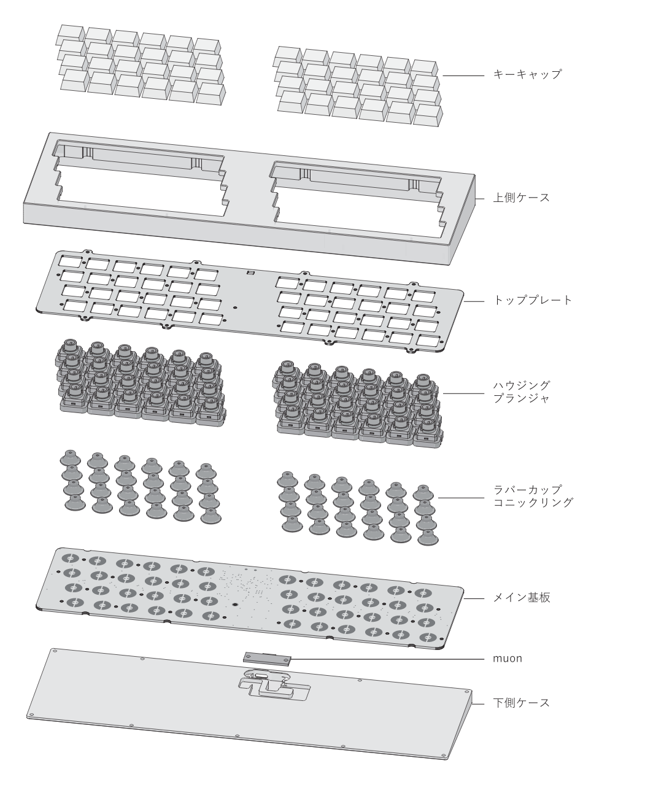
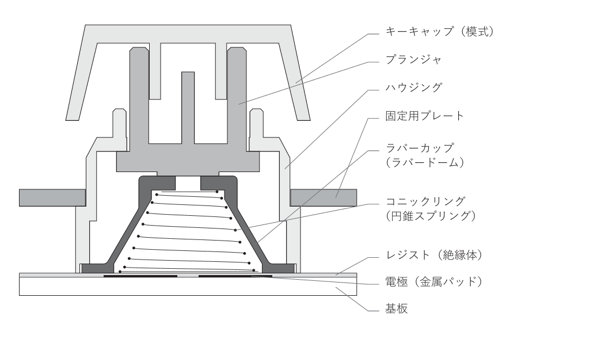
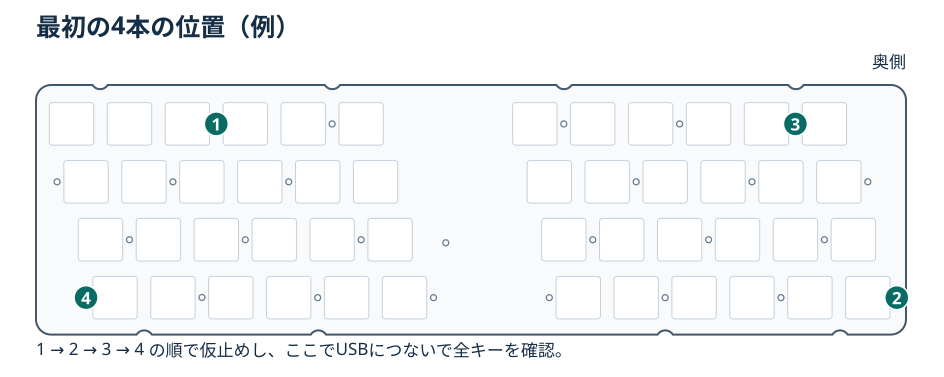
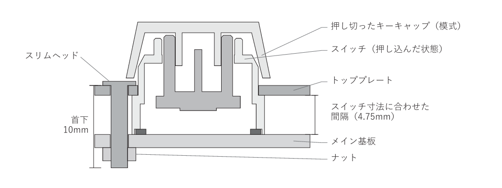

# PRECを組み立てる

対象はSTM32F072を使った**有線のPREC**です。組み立て順は、部品実装 → スイッチの組み立て → 基板の仮止めと動作確認 → ケースへの固定です。

## 1. 足りない部品をはんだ付けする

メイン基板、トッププレート、上下ケース、USB-C小基板（ai03のmuon）とケーブル、ハウジング・スライダー・ラバーカップ・円錐スプリング・キーキャップを用意します。

基板は実装済みを前提にしています。コネクターなどが未実装の個体は、ここで向きを確認して取り付けます。静電容量のキー部品は、次の工程でトッププレートと基板の間に組み込みます。

## 2. ハウジングとスライダーをトッププレートに装着する

スライダーをハウジングに組み、キーキャップを差す軸が表に出る向きにそろえます。ハウジングは**トッププレートの裏から**はめ込みます。左右の爪がかかっていて、軸が引っかからずに上下することを確認します。

## 3. ラバーカップとスプリングを入れる

プレートを裏返し、ハウジングの中央にラバーカップを合わせます。ドームの頂点がスライダー側です。カップの内側に円錐スプリングを置き、**細い側をカップの奥、広い側を基板の電極側**に向けます。シートの縁が折れたり、スプリングが隣のキーへずれたりしていないか見ておきます。

## 4. 主基板を重ね、4本で仮止めして動作を確認する

1. **電極面がスプリングに向く**ように、メイン基板をトッププレートの裏側に当てます。基板を横へ滑らせず、ねじ穴と各キーの中心をそろえます。
2. **首下10 mmのM2スリムヘッド小ねじとM2ナット**を使います。ねじ頭をキー側、ナットを主基板の裏側に置きます。ナットが回るときはラジオペンチで軽く挟んで押さえ、反対側からドライバーで締めます。基板が反るほど締め込まず、片側を一気に締めないようにします。
3. まず下図のように対角線上の4本を仮止めします。絶縁した台に置き、muonをケーブルで仮接続して、[ファームウェアを書き込みます](#書き込みとvialでの校正)。この段階で全キーの押下・解放を確認しておくと、カップやスプリングがずれていても外すねじは4本で済みます。
4. USBを抜いてから残りのねじを入れ、左右を行き来しながら少しずつ締めます。キーキャップを押し切ってもねじ頭に当たらないことを確認します。Vialでの最終校正は本締め後に行います。

## 5. トッププレートを上側ケースに固定する

組み立てたユニットを上側ケースへ入れ、トッププレート外周の張り出しで固定します。工程4のねじとは別の穴です。

| ケース | トッププレート → 上側ケース | 下側ケース → 上側ケース |
| --- | --- | --- |
| アルミ Rev3 | M2×3小ねじ ×8 | M2×5小ねじ ×9 |
| その他のケース | ケース側の受け穴に指定されたねじを使う | ケース側の受け穴に指定されたねじを使う |

アルミRev3の長さは、1.2 mmのトッププレートと上下ケースの図面・CAD寸法から選んだ候補です。最初に1本ずつ仮合わせし、ねじ先が止まり穴の底に届く前に部材が固定されるか確認してください。下側ケースにmuonを留める穴は **M2.5 × 0.45** です。

## 6. 上側ケースと下側ケースを合わせる

下側ケースにmuonを固定し、USB-C端子を開口に合わせてからメイン基板へケーブルをつなぎます。ケーブルをケースの合わせ目やねじ座に挟まないように下側ケースを閉じ、ケース用ねじを締めます。最後にUSBプラグが奥まで入ることと、全キーが押し切れることを確認します。

## 書き込みとVialでの校正

1. **BOOTを押したままUSBにつなぎ**、STM32のDFUモードに入れます。[QMKのSTM32 DFU手順](https://docs.qmk.fm/flashing#stm32-apm32-dfu)に沿って、QMK ToolboxなどでPRECの `prec_vial.bin` を書き込みます。
2. 起動時に未押下の値を測るので、キーから手を離しておきます。[Vial](https://get.vial.today/)を開いてPRECに接続します。
3. Vialの **EC Calibration → Calibration → Bottoming Calibration** をオンにし、各キーを底まで押します。すべて押したらオフにして底打ち値を保存します。
4. しきい値を変える場合は **EC Calibration → Actuation → APC** で調整し、**Save APC Thresholds** で反映・保存します。全キーを一つずつ押し、入力と解放を確かめます。
